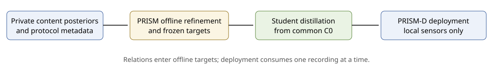

# PRISM-Guard

Code for **Offline Label Correction with Cross-Clip Relations for Compact Multimodal Activity Recognition**.

**Submitted to the IEEE Internet of Things Journal.**

PRISM-Guard (Peer- and Routine-Informed Supervision for compact Models) corrects training labels offline with cross-clip relations: it compares repeated rounds of the same routine, decodes each session under its routine and gates proposed changes. PRISM-Guard-D distills these targets into a compact multimodal recognizer that classifies each clip using only its local sensor inputs.



## Highlights

- PRISM-Guard-D improves macro-F1 over the student distilled from Direct targets by **+4.9** on CUHK-X and **+11.4** on MMAct (paper Table IV).
- CUHK-X Challenge Small Model Track **Finalist Award**, **11th of 326 teams on the private leaderboard**.
- Passed the organizers' independent reproduction and verification; presented a poster at the CUHK-X Challenge Grand Finals at **UbiComp/ISWC 2026**.
- Challenge deployment model: **56.49 MB**, within the **100 MB** limit.
- Challenge team: **砸锅卖铁去比赛**.

## Repository layout

| Folder | Contents |
|---|---|
| `prism/` | PRISM-Guard method (targets, decoding, peers, gates) and PRISM-Guard-D |
| `scripts/` + `configs/` | Entry points and per-dataset settings |
| `experiments/` | Teacher training, students, baselines, ablations and paper figures |
| `competition/` | CUHK-X challenge submission (inference only) |

## Installation

Use Python 3.12 and a fresh virtual environment. Run commands from this directory.

```bash
python -m pip install -e ".[test,student,analysis]"
python -m pytest -q
```

Teacher training and challenge preprocessing have separate optional dependencies:

```bash
python -m pip install -e ".[teachers]"
python -m pip install -e ".[competition]"
```

Training requires your own dataset files and pretrained weights. See [teacher preparation](experiments/teachers/README.md) and [data formats](docs/DATA.md).

## Data preparation

Obtain [CUHK-X](https://openaiotlab.github.io/CUHK-X/), [MMAct](https://mmact19.github.io/2019/) and [MM-Fit](https://mmfit.github.io/) from their official providers under their licenses. This repository contains no datasets, derived caches, predictions or model weights. The verified challenge deployment bundle is published separately as a [release asset](https://github.com/zdymgs/PRISM-Guard/releases/tag/v1.0-challenge) for non-commercial research use.

Keep local inputs and generated outputs outside the source directory:

```text
private-data/                 # your officially obtained datasets
private-weights/              # your pretrained weights and C0 checkpoints
private-cache/
  cuhkx/fold0/
    source.json              # source OOF expert bank and source labels
    posterior.json           # unlabeled target expert bank
    student_manifest.json    # local sensor tensor paths
  mmact/                     # source.json, selection.json, posterior.json
  mmfit/                     # source.json, selection.json, posterior.json
prism-output/                # generated targets, checkpoints and evaluation
PRISM/                       # this repository
```

CLI path options and `PRISM_DATA_ROOT`, `PRISM_CACHE_ROOT`, `PRISM_OUTPUT_ROOT` configure local storage. [DATA.md](docs/DATA.md) describes bank and clip schemas.

## Usage

### 1. Build relational targets

Prepare source and target expert banks using [the teacher code](experiments/teachers/README.md), then construct and select the relational path:

```bash
python scripts/build_targets.py --config configs/cuhkx.yaml --path auto --cache-root ../private-cache/cuhkx/fold0 --output-root ../prism-output/cuhkx/fold0
```

Use `configs/mmact.yaml` or `configs/mmfit.yaml` for the other datasets. Those protocols also consume a separate `selection.json`. Source/selection labels fit the stacker, transitions and gates; target labels are reserved for evaluation. MMAct uses the official cross-subject split: subjects 17–20 for evaluation, subjects 4, 8, 12 and 16 for selection and the remaining subjects for fitting.

### 2. Distill PRISM-Guard-D

```bash
python scripts/distill_student.py --dataset cuhkx --fold 0 --inputs ../private-cache/cuhkx/fold0/student_manifest.json --targets ../prism-output/cuhkx/fold0/targets.json --c0 ../private-weights/cuhkx/fold0/c0.pt --output ../prism-output/cuhkx/fold0/student
```

Repeat with folds 1 and 2 and their corresponding source models and banks. Use `--dataset mmact` or `--dataset mmfit` for their native students. [Student instructions](experiments/students_cuhkx_3fold/README.md) cover source training and input tensors; [baseline instructions](experiments/baselines/README.md) cover KD-soft and confidence pseudo-labeling.

### 3. Evaluate frozen target predictions

```bash
python scripts/evaluate.py --config configs/cuhkx.yaml --cache-root ../private-cache/cuhkx/fold0 --output-root ../prism-output/cuhkx/fold0 --labels ../private-cache/cuhkx/fold0/evaluation_labels.json --reference-predictions ../private-cache/cuhkx/fold0/direct_predictions.json
```

Keep the path overrides identical to target construction. Evaluation checks the frozen target and configuration hashes before reading labels. For the deployed student, use the student evaluation command in [the student instructions](experiments/students_cuhkx_3fold/README.md).

### 4. Recreate the paper figures

```bash
python experiments/analysis/analysis_stats.py ../private-cache/cuhkx/frozen_predictions.npz ../private-cache/cuhkx/metadata.csv ../private-cache/cuhkx/classes.csv ../prism-output/analysis.json
python experiments/analysis/fig3_folds.py ../prism-output/analysis.json ../prism-output/figures
python experiments/analysis/fig4_gains.py --metrics ../prism-output/metrics_long.csv --out ../prism-output/figures/fig4_gains_en.pdf
python experiments/analysis/fig5_7_analysis.py ../prism-output/analysis.json ../prism-output/figures
python experiments/analysis/analysis_pairs.py ../private-cache/cuhkx/frozen_predictions.npz ../private-cache/cuhkx/metadata.csv ../private-cache/cuhkx/classes.csv
```

These scripts generate Figures 3–7 from your local predictions and aggregate metrics. [Formal controls](experiments/ablations/README.md) provide the bank-to-prediction and metric export commands; [analysis instructions](experiments/analysis/README.md) specify the figure input schemas.

## Main results

Macro-F1 (%), paper Table IV:

| Level | Method | CUHK-X | MMAct | MM-Fit |
|---|---|---:|---:|---:|
| Teacher | Direct | 75.0 | 88.5 | 94.6 |
| Teacher | PRISM-Guard | **79.9** | **99.9** | 94.0 |
| Student | From Direct | 75.0 | 88.5 | 94.6 |
| Student | PRISM-Guard-D | **79.9** | **99.9** | 94.0 |

On MM-Fit, where the clip-level estimate is already saturated, the gate keeps relational targets within 0.6 points of the baseline.

[RESULTS.md](RESULTS.md) contains the full Table IV comparison, CUHK-X fold gains from Figure 3, and decoder sensitivity from Table V and computational cost from Table VI.

## Competition

[competition/](competition/README.md) presents the challenge student compact student, input preprocessing and fixed inference procedure, with four schematic diagrams. The challenge submission is an earlier version of PRISM-Guard adapted to the challenge data; its configuration differs in detail from the paper.

## Citation

```bibtex
@misc{prism,
  author = {The PRISM-Guard Authors},
  title = {Offline Label Correction with Cross-Clip Relations for Compact Multimodal Activity Recognition},
  note = {Submitted to the IEEE Internet of Things Journal}
}
```

## License

PRISM-Guard-authored code is provided under the [MIT License](LICENSE). Third-party components and pretrained models follow their respective licenses; see [THIRD_PARTY_NOTICES.md](THIRD_PARTY_NOTICES.md).

## Acknowledgments

We thank AIoT Lab, Department of Information Engineering, The Chinese University of Hong Kong, for creating the CUHK-X dataset and organizing the challenge. When using CUHK-X, cite [A Large-Scale Multimodal Dataset and Benchmarks for Human Activity Scene Understanding and Reasoning](https://dl.acm.org/doi/10.1145/3745756.3809209) (MobiSys 2026). We also thank the MMAct and MM-Fit creators and the authors of the open-source backbones used in this work.
