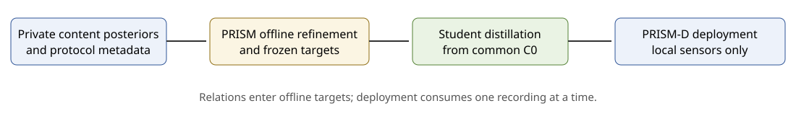

# PRISM-Guard

论文 **Offline Label Correction with Cross-Clip Relations for Compact Multimodal Activity Recognition** 的代码。

**已投稿至 IEEE Internet of Things Journal。**

PRISM-Guard（Peer- and Routine-Informed Supervision for compact Models）通过跨片段关系离线纠正训练标签：比较复现同一流程的多轮记录、按流程解码每个会话、门控决定是否采纳修改。PRISM-Guard-D 将这些目标蒸馏到紧凑多模态学生，部署时逐个处理片段，仅读取该片段的传感器输入。



## 亮点

- 相比以 Direct 目标蒸馏的学生，PRISM-Guard-D 在 CUHK-X 和 MMAct 上的 Macro-F1 分别提高 **+4.9** 和 **+11.4** 个百分点（论文表 IV）。

在已经接近饱和的 MM-Fit 上，闸门将关系目标与基线的差距保持在 0.6 个百分点以内。[RESULTS.md](RESULTS.md) 列出表 IV 的完整比较、图 3 的逐折增益、表 V 的解码器敏感性和表 VI 的计算开销。

比赛队伍“**砸锅卖铁去比赛**”获得 CUHK-X Challenge Small Model Track **Finalist Award**，326 支队伍中私榜第 **11** 名，通过主办方独立复现与核验，并在 UbiComp/ISWC 2026 决赛展示海报。部署模型 **56.49 MB**，满足 **100 MB** 限制。[比赛说明](competition/README.md) 包含模型结构、预处理和推理流程。

## 仓库结构

| 目录 | 内容 |
|---|---|
| `prism/` | PRISM-Guard 方法（目标、解码、同伴、闸门）与 PRISM-Guard-D |
| `scripts/` + `configs/` | 运行入口与各数据集配置 |
| `experiments/` | 教师训练、学生、基线、消融与论文图表 |
| `competition/` | CUHK-X 比赛方案（仅推理） |

## 安装与使用

使用 Python 3.12，在新虚拟环境中运行：

```bash
python -m pip install -e ".[test,student,analysis]"
python -m pytest -q
```

从 [CUHK-X](https://openaiotlab.github.io/CUHK-X/)、[MMAct](https://mmact19.github.io/2019/) 和 [MM-Fit](https://mmfit.github.io/) 官方渠道取得数据，并自行准备预训练权重。本仓库不提供数据、缓存、预测和模型权重。通过比赛验证的部署权重单独作为 [Release 附件](https://github.com/zdymgs/PRISM-Guard/releases/tag/v1.0-challenge) 发布，仅限非商业研究使用。数据及生成结果放在源码目录外；格式见 [docs/DATA.md](docs/DATA.md)。

完整可执行命令见 [英文主页 Usage](README.md#usage)，依次为教师准备、构建目标、蒸馏学生、冻结评测与生成图 3–7。路径可用命令行参数或 `PRISM_DATA_ROOT`、`PRISM_CACHE_ROOT`、`PRISM_OUTPUT_ROOT` 配置。教师代码和比赛预处理分别使用 `.[teachers]`、`.[competition]` 可选依赖。MMAct 使用官方跨受试者划分：受试者 17–20 用于评估，受试者 4、8、12、16 用于选择，其余受试者用于拟合。

## 引用、许可与致谢

论文引用占位见 [英文主页](README.md#citation)，作者暂写 `The PRISM-Guard Authors`。本项目原创代码使用 [MIT](LICENSE)，第三方组件遵循各自许可，详见 [THIRD_PARTY_NOTICES.md](THIRD_PARTY_NOTICES.md)。

感谢香港中文大学信息工程学系 AIoT Lab 创建 CUHK-X 数据集并组织挑战赛。使用数据时请引用 [CUHK-X 原论文](https://dl.acm.org/doi/10.1145/3745756.3809209)。同时感谢 MMAct、MM-Fit 数据集和所用开源骨干的作者。
