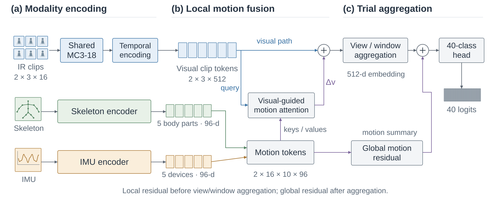
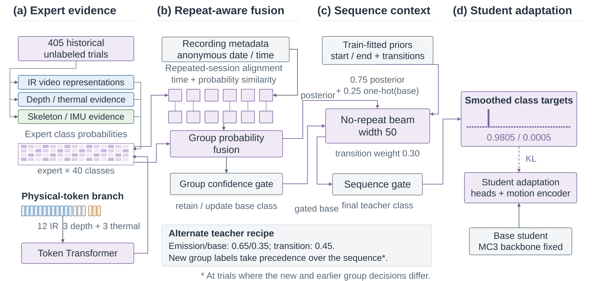
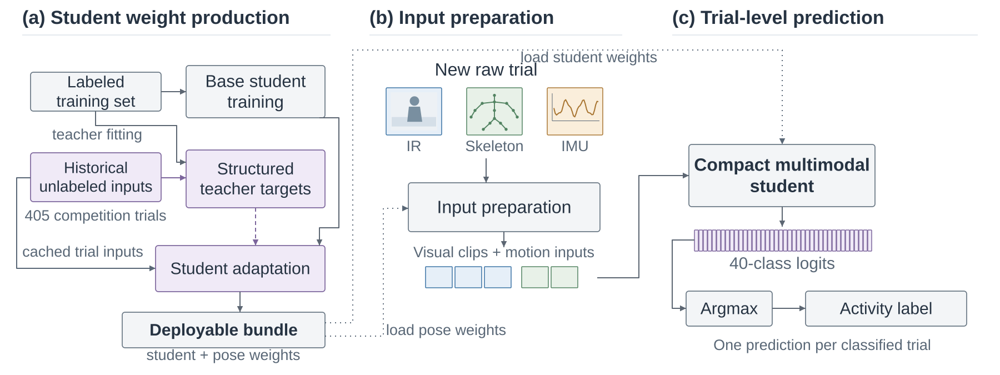
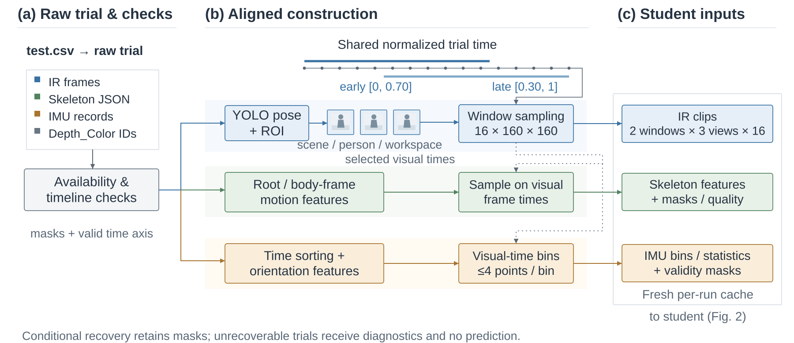

# CUHK-X Challenge: compact multimodal student

Team **砸锅卖铁去比赛** received the **Finalist Award** in the CUHK-X Challenge Small Model Track, placed **11th on the private leaderboard (Top 15)**, passed the organizer's independent reproduction and verification, and presented a poster at the UbiComp/ISWC 2026 CUHK-X Challenge Grand Finals.

The challenge submission is an earlier version of PRISM adapted to the challenge data; its configuration differs in detail from the paper.

## Student and teacher supervision

The deployed challenge student uses a shared **MC3-18** encoder for **two temporal windows × three views**: scene, person, and workspace. Each clip contains 16 infrared frames resized to 160 × 160. Five skeleton body-part tokens and five wearable IMU device tokens retain local motion information. Visual queries attend to motion tokens within each window; a global motion residual is added after view and window aggregation. The resulting trial representation produces 40-class logits.



Training uses complementary visual, depth, thermal, skeleton, and IMU teacher evidence. Repeated sessions are aligned by clip time and probability similarity. Group confidence gates and no-repeat beam decoding select structured teacher targets for the compact student.



Normal student classification uses infrared, skeleton, and IMU inputs. `Depth_Color` frame indices support preprocessing alignment; conditional recovery can use available depth or thermal timelines and grayscale inputs.

## Installation and resources

From the repository root:

```bash
python -m pip install -e ".[competition]"
```

Obtain CUHK-X data from the organizers. The verified deployment bundle, `challenge_bundle.pth`, is available as a [release asset](https://github.com/zdymgs/PRISM/releases/tag/v1.0-challenge) for non-commercial research use. The runtime expects a trusted `prism-challenge-checkpoint-v1` bundle containing the student state and architecture configuration together with the YOLO11n-pose checkpoint bytes. Set `PRISM_COMPETITION_BUNDLE` to its local location or pass `--bundle` explicitly. The package does not download models during inference.

The challenge environment used Python 3.12, PyTorch 2.9.1, and torchvision 0.24.1. Frozen package versions are recorded in [environment/requirements-lock.txt](environment/requirements-lock.txt); see [environment/README.md](environment/README.md) for installation notes.

## Raw input

Provide a label-free `test.csv` with a `path` column and an optional empty `prediction` column. Paths are relative to the supplied data directory. Preserve the original modality filenames and timestamps.

```text
data/
  test.csv
  evaluation/
    sample_001/
      IR/
      Depth_Color/
      Skeleton/predictions/
      IMU/
```

Example CSV structure:

```csv
path,prediction
evaluation/sample_001/,
```

## Fixed inference

Run from the repository root, using your own data and bundle:

```bash
python competition/student/runtime.py \
  --bundle weights/challenge_bundle.pth \
  --data-root data \
  --test-csv data/test.csv \
  --output outputs/challenge
```

The Bash interface reads `test.csv` from the data directory and writes to the exact CSV path:

```bash
bash competition/inference.sh data outputs/challenge.csv weights/challenge_bundle.pth
```

Both interfaces support `--help`. The Python runtime also reads the bundle location from `PRISM_COMPETITION_BUNDLE` when `--bundle` is omitted. Defaults remain batch size 4 and automatic device selection.



Each run rebuilds pixel, motion, and MC3 feature inputs from raw trials in a new temporary workspace. The runtime performs fixed student inference and writes `submission.csv`, `diagnostics.json`, and `report.json`. Missing modalities use availability masks and deterministic recovery; unrecoverable trials are identified in diagnostics. Check that output rows and order match the input before using the predictions.

The deployment bundle occupies **56.49 MB**, including pose preprocessing weights, within the **100 MB** track limit. the challenge student processed the 405-trial input in **224 seconds on WSL2** with an RTX 5070 Ti Laptop GPU.

## Preprocessing and code layout



- [student/runtime.py](student/runtime.py): fresh-workspace orchestration and diagnostics.
- [student/infer_student.py](student/infer_student.py): fixed student forward pass over freshly built inputs.
- [student/modules/](student/modules/): deployment architecture, raw-input builders, and their shared imports.
- [preprocessing/README.md](preprocessing/README.md): builder entry points and input contracts.
- [configs/challenge_student.yaml](configs/challenge_student.yaml): deployment mapping and fixed defaults.

## Third-party software and attribution

MC3-18 is provided by torchvision. YOLO11n-pose is invoked through Ultralytics for pose and ROI preprocessing; Ultralytics is licensed under AGPL-3.0. Its license remains in [docs/licenses/Ultralytics_LICENSE.txt](docs/licenses/Ultralytics_LICENSE.txt). The repository contains invocation code and no model weights; see [the project notices](../THIRD_PARTY_NOTICES.md) for component licenses.

We thank **AIoT Lab, Department of Information Engineering, The Chinese University of Hong Kong** for creating CUHK-X and organizing the challenge. Dataset reference: Siyang Jiang et al., *A Large-Scale Multimodal Dataset and Benchmarks for Human Activity Scene Understanding and Reasoning*, MobiSys 2026. [DOI:10.1145/3745756.3809209](https://doi.org/10.1145/3745756.3809209).
